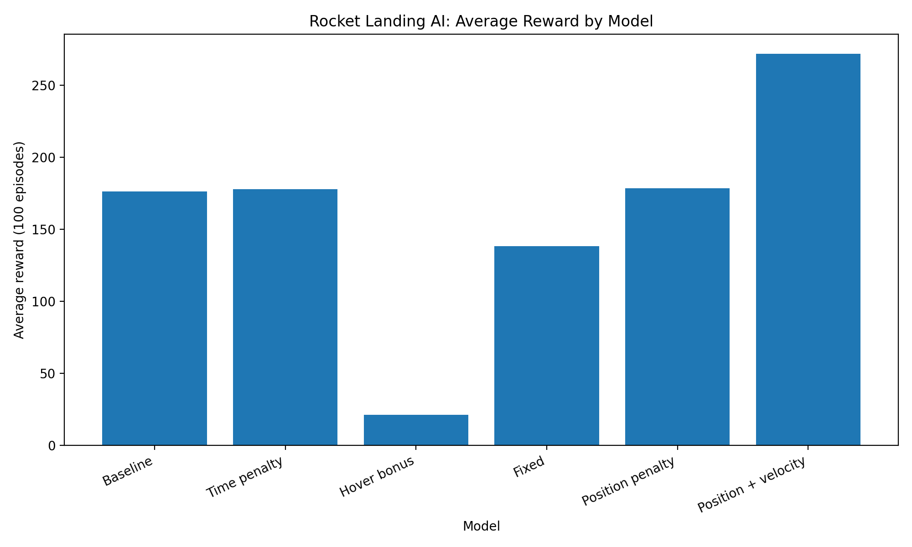
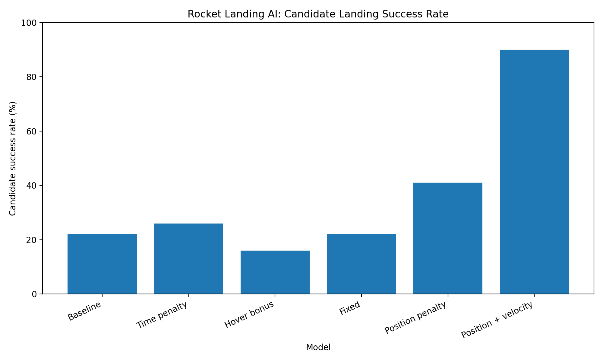

# 🚀 Rocket Landing AI

A reinforcement learning project that trains an AI agent to land a lunar lander in the Gymnasium `LunarLander-v3` environment using Proximal Policy Optimization (PPO).

The project investigates how different reward designs affect the agent's landing performance.

## 🎯 Project Objective

Train an agent to control a simulated lunar lander and compare several reward strategies to understand which produces the most effective landing behavior.

## 🧰 Technologies Used

- Python
- Gymnasium
- Stable-Baselines3
- Proximal Policy Optimization (PPO)
- NumPy
- Matplotlib

## 🧠 How It Works

The agent repeatedly interacts with a simulated environment:

1. **Observation:** The environment provides information about the lander's position, velocity, angle, angular velocity, and leg contacts.
2. **Action:** The agent chooses controls to operate the lander's engines.
3. **Reward:** The environment scores the outcome. Custom reward experiments modify this feedback.
4. **Learning:** PPO updates the policy using experience collected during training.
5. **Evaluation:** Trained models are compared over 100 episodes using the same reset seeds.

## 🧪 Reward Experiments

Six models were evaluated:

- **Baseline:** Uses the environment's original reward.
- **Time penalty:** Adds a small penalty at each timestep.
- **Hover bonus:** Rewards states where the lander is upright and moving slowly.
- **Fixed:** A separately trained experiment using the same timestep penalty.
- **Position penalty:** Penalizes horizontal displacement from the center.
- **Position + velocity:** Penalizes both horizontal displacement and horizontal velocity.

The position-and-velocity experiment uses these additional reward terms:

```python
reward -= 0.5 * abs(horizontal_position)
reward -= 0.2 * abs(horizontal_velocity)
```

These terms encourage the agent to stay closer to the center and reduce sideways movement.

## 📊 Results


All six models were evaluated over 100 episodes with reset seeds 0–99. Actions were deterministic during evaluation.

| Model | Average Reward | Reward Std. Dev. | Reward >= 200 | Candidate Successes |
|---|---:|---:|---:|---:|
| Baseline | 176.19 | 74.47 | 47/100 | 22/100 |
| Time Penalty | 177.69 | 86.64 | 59/100 | 26/100 |
| Hover Bonus | 21.32 | 88.79 | 2/100 | 16/100 |
| Fixed | 138.32 | 108.01 | 47/100 | 22/100 |
| Position Penalty | 178.46 | 94.40 | 57/100 | 41/100 |
| Position + Velocity | **271.81** | **27.64** | **98/100** | **90/100** |


### Result Visualizations

**Average reward**



**Candidate landing success rate**



The position-and-velocity model achieved the highest average reward and the highest candidate success rate among the six experiments.

## ⚙️ Setup and Execution

### 1. Clone the repository

```bash
git clone YOUR_GITHUB_REPOSITORY_URL
cd rocket-landing-ai
```

Replace `YOUR_GITHUB_REPOSITORY_URL` with the URL of your repository.

### 2. Create and activate a virtual environment

On Windows PowerShell:

```powershell
python -m venv .venv
.\.venv\Scripts\Activate.ps1
```

If PowerShell blocks script activation, use an appropriate process-scoped execution-policy workaround for your session.

### 3. Install dependencies

```bash
pip install gymnasium[box2d] stable-baselines3
```

If your project uses a separate dependency file, install from that file instead.

### 4. Run the project

Run the scripts from the project directory using the activated environment. For example:

```bash
python 01_random_lander.py
python 05_evaluate_model.py
```

The evaluation script expects the saved model files to be available in the project directory.

## ⚠️ Limitations

- The candidate landing-success metric is an approximation based on the final reward and final observation.
- The metric does not guarantee that every counted landing is physically safe.
- Results are based on 100 evaluation seeds per model; more seeds would strengthen the comparison.
- The experiments compare different reward designs, but additional controlled trials would help establish how consistently each design performs.

## 🔮 Future Improvements

- Develop a more rigorous landing-success detector.
- Evaluate over more random seeds.
- Compare multiple training runs per reward design.
- Record and compare training curves.
- Add a video demonstration of the best model.
- Improve reproducibility with a documented dependency file.

## 👨‍💻 Project Summary

This project demonstrates a practical reinforcement learning workflow: training a PPO agent, modifying reward functions, evaluating trained policies under consistent conditions, and analyzing the results.
